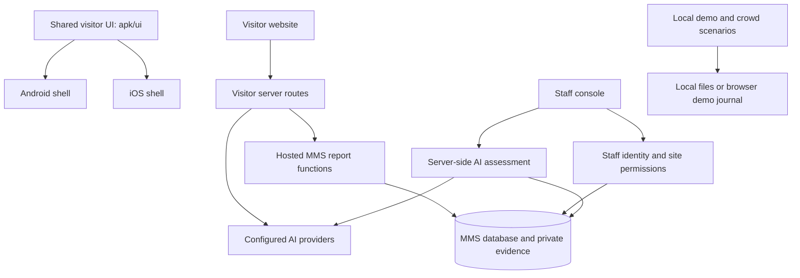

# Architecture

Sanskriti has four application surfaces with explicit build and service boundaries.
The two native clients share a bundled interface; the visitor website and staff
console are separately built Next.js applications.

The diagram describes source-level paths, not the deployment status of any service.
Native clients also have provider and backend integrations; a bundled UI does not
make online features available without connectivity and configuration.

## Build boundaries

| Surface | Runtime | Build ownership |
| --- | --- | --- |
| Android | Java shell and WebView with native bridges | Gradle builds the shared static UI and packages it as assets |
| iOS | Swift, WKWebView and loopback asset server | Xcode copies the shared export and verifies its manifest |
| Visitor website | Next.js pages and Node server routes | Independent package and lockfile in `apps/visitor-web` |
| Operations | Next.js staff interface and server routes | Root npm workspace and lockfile |

The mobile export excludes `app/api`; native device services and configured
external services handle capabilities a static export cannot provide. Android
and iOS preserve compatible bridge contracts for speech, camera, navigation and
other device interactions. See the [native navigation contract](../apk/docs/ar-navigation-controller.md).

## Visitor services

The website keeps provider secrets in server modules. Its routes handle chat,
recognition, transcription, narration, translation, Heritage Watch and reporting.
Input limits and in-memory rate limits are application safeguards; process-local
limits do not establish a deployment-wide abuse-control system.

Reporting selects the hosted MMS adapter when both public database settings are
present. Otherwise development can use a loopback-only bridge to the local demo.
Vercel never uses that local bridge. Receipt status requires the private receipt
contract; visitor name entry itself is not authentication.

The public-report database path uses the intended project's anonymous session and
report functions. Staff access is a different identity and permission boundary.
A successful catalogue read or configured key alone is not proof that every
submission, evidence or staff workflow has been accepted.

## Staff and incident services

The main MMS reads site-scoped data through authenticated database access policies
and workflow functions. Incident assessment routes verify the user and site role
before loading the saved incident and private evidence. A manager-requested AI
assessment is advisory and must not silently change assignment or incident status.

`supabase/migrations/` records MMS database changes. Marketplace migrations and
functions under `apk/ui/supabase/` are a separate domain and deployment history.
Do not merge histories or assume that either directory bootstraps every prerequisite
of an empty database. Review the target environment before applying migrations.

## Demonstration isolation

The original incident sandbox uses local JSON files with serialised writes and
version checks. These stores require a single process and are unsuitable for a
public multi-instance service. Sample staff selectors are not authentication.

The local `/taj-pilot` route provides synthetic crowd scenarios and a browser
journal. When deployed with `VERCEL` set, that route selects the MMS crowd
interface. `/mms/crowd` is the integrated interface. Persistent demonstration data
still represents simulations, not measured live monument conditions.

Camera estimates, consented presence and entry/exit records are complementary
signals, not populations to add together. Stale or uncovered zones are unknown.
No current simulation establishes camera accuracy, authorised ticket validation
or production alert performance. See [crowd inputs](crowd-inputs.md) and the
[pilot delivery record](taj-pilot-delivery.md).

## Production acceptance

Verify site isolation, evidence access, credential boundaries, retention,
restoration, device permissions and user journeys in the intended deployment.
Keep private inference credentials out of release app bundles. Validate any real
camera or ticket integration against agreed site requirements before presenting
its output as operational. The [release checklist](engineering/release-checklist.md)
records the required evidence.
